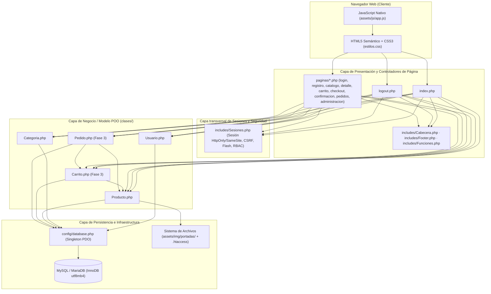
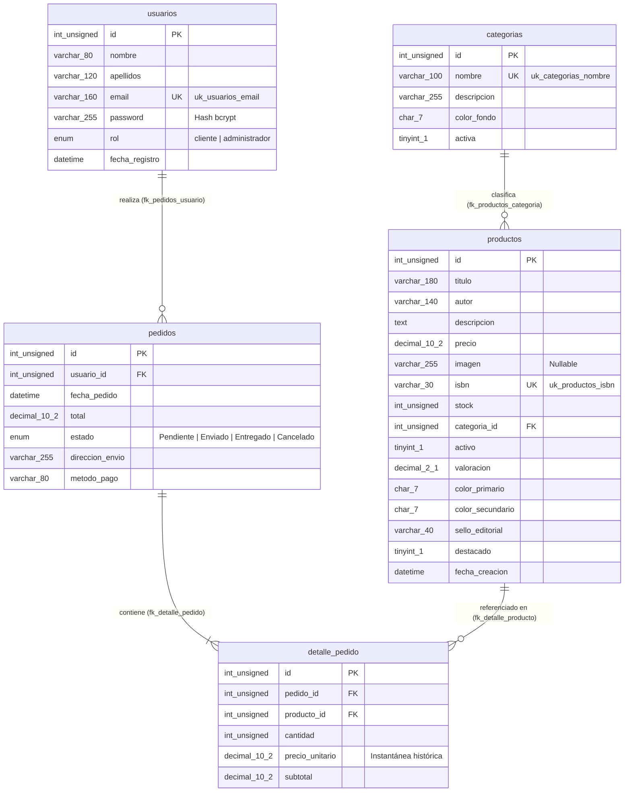
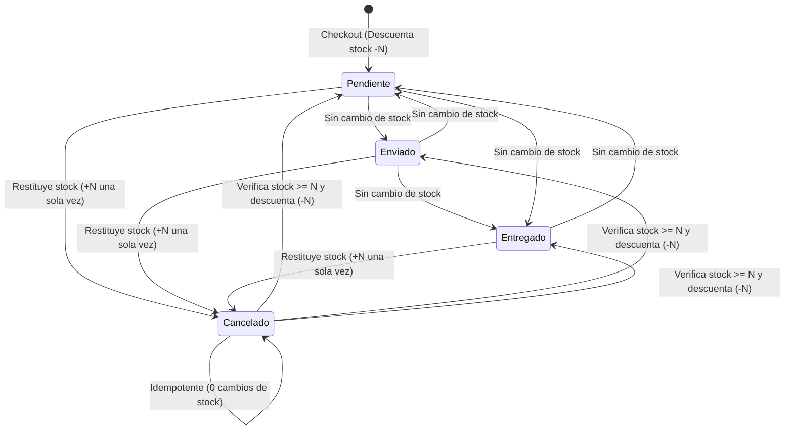

# AUDITORÍA TÉCNICA Y DOCUMENTACIÓN INTEGRAL DE LIBRESHOP

**Proyecto:** LibreShop — Librería Online y Sistema de Comercio Electrónico  
**Repositorio:** `https://github.com/MARIO-24/LibreShop.git`  
**Ramas auditadas:** `entrega-1-sin-carrito` (Fases 1 y 2) y `entrega-final-con-carrito` (Fases 1, 2 y 3)  
**Rama protegida (intacta):** `main` (`c3f41953785a5114ef3286cddac4c426e03e1599`)  
**Entorno de ejecución:** XAMPP (Apache 2.4 + PHP 8.2 + MySQL / MariaDB InnoDB `utf8mb4`)

---

## 6.1. Descripción general de LibreShop

### Qué es LibreShop y qué problema resuelve
**LibreShop** es una aplicación web completa de comercio electrónico especializada en la venta de libros y gestión editorial, desarrollada íntegramente en **PHP 8 con Programación Orientada a Objetos (POO)**, **PDO MySQL** y una interfaz responsive fiel al diseño original de Figma Make.

Resuelve de extremo a extremo las necesidades de una librería digital moderna:
1. **Exposición y descubrimiento editorial**: portada con novedades, selección destacada, categorías temáticas y buscador multicriterio con filtros dinámicos y ordenación.
2. **Identidad visual adaptable para cada obra**: sistema dual de portadas que combina cubiertas editoriales vectoriales parametrizables (colores primario/secundario y sello tipográfico) con subida segura de imágenes físicas (`JPG`, `PNG`, `WebP`).
3. **Autenticación y control de acceso por roles (RBAC)**: separación estricta entre visitantes anónimos, clientes registrados (`cliente`) y gestores del catálogo (`administrador`).
4. **Flujo transaccional de compra e inventario**: carrito persistente en sesión sincronizado en tiempo real con el stock de MySQL, pasarela simulada de *checkout* con cálculo automático de gastos de envío y gestión de estados de pedidos con bloqueo pesimista (`SELECT ... FOR UPDATE`) para garantizar la integridad del inventario.

### Fases del proyecto y diferencias entre ramas

| Rama de Git | Fases incluidas | Alcance funcional |
| :--- | :--- | :--- |
| `entrega-1-sin-carrito` | **Fase 1** (Gestor de Productos y Categorías) + **Fase 2** (Autenticación, Sesiones y Roles) | Catálogo público, búsqueda y filtros, ficha de detalle, registro e inicio/cierre de sesión con CSRF, panel de administración completo de libros y categorías con subida de portadas. Las vistas de carrito y pedidos muestran avisos informativos de preparación para la Fase 3. |
| `entrega-final-con-carrito` | **Fase 1** + **Fase 2** + **Fase 3** (Carrito, Checkout y Gestión de Pedidos) | Todo lo anterior más `clases/Carrito.php`, `clases/Pedido.php`, carrito de compra interactivo, proceso de *checkout* transaccional con descuento de stock, confirmación de compra, historial de pedidos del cliente y gestión administrativa de pedidos con transiciones libres entre los 4 estados (`Pendiente`, `Enviado`, `Entregado`, `Cancelado`) y control automático de stock. |
| `main` | Base inicial del repositorio | Permanece intacta sin modificaciones directas, sirviendo como línea base histórica del repositorio. |

---

## 6.2. Arquitectura general del proyecto

LibreShop sigue una **arquitectura multicapa modular en PHP nativo** inspirada en la separación Modelo-Vista-Controlador (MVC) adaptada a páginas multipágina (MPA):



### Flujo de una petición HTTP en LibreShop
1. **Recepción de la solicitud**: Apache entrega la petición al script PHP solicitado (`index.php`, `logout.php` o `paginas/*.php`).
2. **Inicialización de sesión y seguridad (`includes/Sesiones.php`)**: se configura la cookie de sesión (`HttpOnly`, `SameSite=Lax`, `use_strict_mode=1`), se inicia la sesión y se asegura la existencia del token CSRF (`$_SESSION['csrf_token']`).
3. **Verificación de permisos (RBAC)**:
   - Si la página requiere usuario autenticado (`checkout.php`, `confirmacion.php`, `pedidos.php`), se ejecuta `requerirAutenticacion()`.
   - Si la página es exclusiva de administración (`administracion.php`), se ejecuta `requerirAdministrador()`.
4. **Procesamiento de acciones `POST` (Patrón PRG — *Post/Redirect/Get*)**:
   - Se valida el token CSRF mediante `verificarCSRF()` (`hash_equals`).
   - Se invoca el método correspondiente de la clase de dominio (`Usuario`, `Producto`, `Categoria`, `Carrito`, `Pedido`).
   - Se almacena un mensaje *flash* en sesión (`establecerFlash()`) y se redirige con `header('Location: ...')` para evitar reenvíos de formularios al recargar.
5. **Consulta de datos y renderizado de la vista**: se obtienen los registros desde MySQL, se incluye `includes/Cabecera.php`, se pinta el contenido escapando toda salida con `e()` (`htmlspecialchars`) y se cierra el documento con `includes/Footer.php` y `assets/js/app.js`.

---

## 6.3. Tecnologías utilizadas y función de cada una

### 1. PHP 8 (`declare(strict_types=1)`)
- **Por qué se usa**: lenguaje principal de servidor requerido para implementar la lógica de negocio sin frameworks externos.
- **Dónde se usa**: en los 21 archivos `.php` del proyecto (`index.php`, `logout.php`, `config/`, `includes/`, `clases/`, `paginas/`).
- **Qué problema resuelve**: tipado estricto (`strict_types=1`), validación en servidor, gestión de sesiones, autenticación segura con `password_hash()` / `password_verify()`, subida verificada de archivos y generación dinámica de HTML.

### 2. Programación Orientada a Objetos (POO)
- **Por qué se usa**: encapsula las reglas de negocio y el acceso a datos de cada entidad en clases cohesivas y reutilizables.
- **Dónde se usa**: directorio `clases/` (`Usuario`, `Categoria`, `Producto`, `Carrito`, `Pedido`) y `config/database.php` (`Database`).
- **Qué problema resuelve**: evita mezclar consultas SQL en las vistas HTML, centraliza las validaciones de dominio y permite inyectar la conexión `PDO` en pruebas automatizadas.

### 3. PDO (PHP Data Objects)
- **Por qué se usa**: capa de abstracción de acceso a bases de datos oficial de PHP con soporte nativo para sentencias preparadas reales y transacciones ACID.
- **Dónde se usa**: `config/database.php` y todas las clases de `clases/`.
- **Qué problema resuelve**: erradica la inyección SQL mediante `PDO::ATTR_EMULATE_PREPARES => false`, lanza excepciones tipadas (`PDO::ERRMODE_EXCEPTION`) y coordina bloqueos de fila con `beginTransaction()`, `commit()` y `rollBack()`.

### 4. MySQL / MariaDB (Motor InnoDB, `utf8mb4_unicode_ci`)
- **Por qué se usa**: sistema gestor de bases de datos relacional con soporte para claves foráneas, índices compuestos y bloqueo a nivel de fila.
- **Dónde se usa**: definición en `database.sql` y consumo desde `clases/`.
- **Qué problema resuelve**: persistencia relacional íntegra de `usuarios`, `categorias`, `productos`, `pedidos` y `detalle_pedido`.

### 5. HTML5 Semántico
- **Por qué se usa**: estructura accesible y semántica de todas las páginas.
- **Dónde se usa**: `includes/Cabecera.php`, `includes/Footer.php`, `index.php` y `paginas/*.php`.
- **Qué problema resuelve**: organización clara mediante `<header>`, `<nav>`, `<main>`, `<section>`, `<article>`, `<aside>`, `<form>`, `<table>` y atributos de accesibilidad (`aria-label`, `role="alert"`, `required`).

### 6. CSS3 (`assets/css/estilos.css`)
- **Por qué se usa**: hoja de estilos propia y autónoma (sin depender de CDNs externos para funcionar sin conexión) que implementa los componentes editoriales y las utilidades de maquetación del diseño de Figma Make.
- **Dónde se usa**: cargada en `includes/Cabecera.php` desde `assets/css/estilos.css`.
- **Qué problema resuelve**: diseño *responsive* móvil/escritorio, sistema de rejillas CSS Grid y Flexbox, cubiertas vectoriales tridimensionales (`.book-cover`), etiquetas de estado (`.status`) y variables de marca (`--navy: #142943`, `--blue: #1760dc`).

### 7. JavaScript Nativo ES6+ (`assets/js/app.js`)
- **Por qué se usa**: mejora progresiva (*progressive enhancement*) de la experiencia de usuario en el navegador sin librerías pesadas.
- **Dónde se usa**: cargado al final de `includes/Footer.php`.
- **Qué problema resuelve**: apertura/cierre del menú móvil, botones `−`/`+` de cantidad, selector interactivo de método de pago, prevención de doble envío en *checkout*, previsualización en vivo de portadas en administración, conmutación automática entre imagen subida y personalización editorial, y diálogos de confirmación antes de acciones destructivas.

### 8. Sesiones PHP y Seguridad (`includes/Sesiones.php`, `assets/img/portadas/.htaccess`)
- **Por qué se usa**: HTTP es un protocolo sin estado; las sesiones mantienen la identidad del usuario, el carrito y los tokens CSRF.
- **Dónde se usa**: inicializado en `includes/Sesiones.php` y directiva Apache en `assets/img/portadas/.htaccess`.
- **Qué problema resuelve**: prevención de robo de sesión por XSS (`httponly`), prevención de fijación de sesión (`session_regenerate_id(true)`), mitigación de CSRF (`hash_equals`) y bloqueo de ejecución de scripts en la carpeta de subida de imágenes.

---

## 6.4. Estructura completa de carpetas y archivos

```text
LibreShop/
├── .gitignore                        # Exclusión de archivos temporales, IDE, .env y portadas subidas
├── README.md                         # Guía rápida del proyecto, credenciales y resumen funcional
├── AUDITORIA_TECNICA_LIBRESHOP.md    # Documentación técnica integral y memoria de auditoría
├── database.sql                      # Esquema DDL e inserción idempotente de datos iniciales MySQL
├── index.php                         # Página de inicio (Hero, ventajas, destacados, categorías, novedades)
├── logout.php                        # Endpoint exclusivo POST + CSRF para cierre seguro de sesión
├── config/
│   └── database.php                  # Clase Database (Singleton PDO) y auto-inicialización de database.sql
├── includes/
│   ├── Sesiones.php                  # Gestión de sesiones, autenticación, roles, CSRF y mensajes flash
│   ├── Funciones.php                 # Helpers de escape HTML, formato de moneda/fechas, iconos SVG y tarjetas
│   ├── Cabecera.php                  # <head>, barra de navegación superior, buscador, carrito, sesión y flash
│   └── Footer.php                    # Pie de página corporativo e inclusión de assets/js/app.js
├── clases/
│   ├── Categoria.php                 # Modelo POO para CRUD, conteo y baja lógica de categorías
│   ├── Producto.php                  # Modelo POO para CRUD, filtros, subida de portadas y stock de libros
│   ├── Usuario.php                   # Modelo POO para registro, login, bcrypt y cuentas demo
│   ├── Carrito.php                   # [Solo entrega final] Gestión de carrito en sesión validado contra MySQL
│   └── Pedido.php                    # [Solo entrega final] Checkout ACID, historial y máquina libre de estados
├── paginas/
│   ├── login.php                     # Formulario y controlador de inicio de sesión con redirección segura
│   ├── registro.php                  # Formulario y controlador de alta de clientes nuevos
│   ├── catalogo.php                  # Catálogo público con búsqueda, filtro por categoría y ordenación
│   ├── detalle.php                   # Ficha individual del libro, selector de cantidad y libros relacionados
│   ├── carrito.php                   # Gestión de líneas del carrito (o aviso Fase 3 en entrega 1)
│   ├── checkout.php                  # Formulario de dirección, método de pago y confirmación de compra
│   ├── confirmacion.php              # Recibo detallado del pedido recién confirmado
│   ├── pedidos.php                   # Historial de pedidos realizados por el cliente autenticado
│   └── administracion.php            # Panel de control para productos, categorías y pedidos (solo admin)
└── assets/
    ├── css/
    │   └── estilos.css               # Sistema de diseño completo, componentes y utilidades responsive
    ├── js/
    │   └── app.js                    # Lógica interactiva en cliente y previsualización dinámica de portadas
    └── img/
        └── portadas/
            ├── .gitkeep              # Mantiene versionado el directorio de subida de portadas
            └── .htaccess             # Deshabilita la ejecución de scripts PHP/CGI en el directorio de subidas
```

---

## 6.5. Explicación detallada archivo por archivo

### Tabla resumen del inventario de archivos

| Archivo | Extensión | Tecnología | Función | Qué hace |
| :--- | :--- | :--- | :--- | :--- |
| `.gitignore` | `.gitignore` | Git | Control de exclusiones | Ignora archivos de entorno (`.env`), carpetas de IDE y portadas subidas en pruebas, conservando `.gitkeep` y `.htaccess`. |
| `README.md` | `.md` | Markdown | Documentación de usuario | Resume las características del proyecto, requisitos de XAMPP y credenciales de demostración. |
| `AUDITORIA_TECNICA_LIBRESHOP.md` | `.md` | Markdown | Auditoría y arquitectura | Documenta exhaustivamente la arquitectura, código, base de datos, flujos, seguridad y pruebas realizadas. |
| `database.sql` | `.sql` | SQL (MySQL) | Esquema y semilla inicial | Crea las 5 tablas (`usuarios`, `categorias`, `productos`, `pedidos`, `detalle_pedido`), claves foráneas y datos semilla idempotentes. |
| `config/database.php` | `.php` | PHP 8 + PDO | Conexión a base de datos | Define la clase `Database` con patrón Singleton PDO y auto-importación de `database.sql` si la BD aún no existe. |
| `includes/Sesiones.php` | `.php` | PHP 8 | Sesiones, RBAC y CSRF | Configura cookies seguras, gestiona el usuario en sesión, verifica roles (`esAdministrador`), tokens CSRF y mensajes *flash*. |
| `includes/Funciones.php` | `.php` | PHP 8 + SVG | Helpers de vista | Proporciona `e()`, `formatoPrecio()`, `formatoFechaEspanol()`, `renderizarEstadoPedido()`, `icono()`, `renderizarPortada()` y `renderizarTarjetaProducto()`. |
| `includes/Cabecera.php` | `.php` | PHP 8 + HTML5 | Cabecera global | Renderiza el `<head>`, barra de navegación responsive, contador del carrito, controles de usuario/admin, botón POST «Cerrar sesión» y alertas *flash*. |
| `includes/Footer.php` | `.php` | PHP 8 + HTML5 | Pie de página global | Renderiza enlaces de navegación inferior, información editorial e inyecta `assets/js/app.js`. |
| `clases/Usuario.php` | `.php` | PHP 8 POO + PDO | Entidad Usuario | Gestiona el registro de clientes, autenticación con `password_verify()`, *rehashing* automático y cuentas de demostración. |
| `clases/Categoria.php` | `.php` | PHP 8 POO + PDO | Entidad Categoría | Gestiona el CRUD de categorías, conteo de libros activos y baja lógica cuando existen libros asociados. |
| `clases/Producto.php` | `.php` | PHP 8 POO + PDO | Entidad Producto | Gestiona el CRUD de libros, filtros de catálogo, validación y subida segura de portadas, limpieza de imágenes huérfanas y estadísticas. |
| `clases/Carrito.php` | `.php` | PHP 8 POO + PDO | Entidad Carrito (Fase 3) | Sincroniza `$_SESSION['carrito']` con el stock y precios reales de MySQL, calculando subtotales y gastos de envío. |
| `clases/Pedido.php` | `.php` | PHP 8 POO + PDO | Entidad Pedido (Fase 3) | Crea pedidos mediante transacciones ACID con `SELECT ... FOR UPDATE` y gestiona cambios de estado con restitución/descuento de stock. |
| `index.php` | `.php` | PHP 8 + HTML5 | Portada principal | Muestra el *hero* con buscador, libro recomendado, tarjetas de ventajas, libros destacados, categorías con conteo y últimas novedades. |
| `logout.php` | `.php` | PHP 8 | Cierre de sesión | Procesa exclusivamente peticiones `POST` con token CSRF válido, destruye la sesión con `cerrarSesionUsuario()` y redirige al inicio. |
| `paginas/login.php` | `.php` | PHP 8 + HTML5 | Inicio de sesión | Autentica a clientes y administradores, previene *Open Redirect* y ofrece botones de autocompletado para las cuentas demo. |
| `paginas/registro.php` | `.php` | PHP 8 + HTML5 | Registro de clientes | Valida el formulario de alta, crea la cuenta con rol `cliente`, inicia sesión automáticamente y redirige a la portada. |
| `paginas/catalogo.php` | `.php` | PHP 8 + HTML5 | Catálogo de libros | Lista los libros activos filtrados por texto (`q`), categoría (`categoria`) y criterio de ordenación (`orden`). |
| `paginas/detalle.php` | `.php` | PHP 8 + HTML5 | Ficha de producto | Muestra toda la información de un libro, su portada, disponibilidad de stock, formulario para añadir al carrito y 4 obras relacionadas. |
| `paginas/carrito.php` | `.php` | PHP 8 + HTML5 | Vista del carrito | Permite incrementar, decrementar, eliminar libros o vaciar el carrito mediante formularios `POST` con CSRF y ver el desglose de costes. |
| `paginas/checkout.php` | `.php` | PHP 8 + HTML5 | Confirmación de compra | Recoge los datos de envío y método de pago (`Tarjeta` o `PayPal`) y ejecuta `Pedido::crearDesdeCarrito()`. |
| `paginas/confirmacion.php` | `.php` | PHP 8 + HTML5 | Recibo post-compra | Muestra el resumen completo y código `#LS-YYYY-NNNN` del pedido recién confirmado por el cliente. |
| `paginas/pedidos.php` | `.php` | PHP 8 + HTML5 | Historial del cliente | Lista todos los pedidos del cliente autenticado con sus líneas de detalle, importes, dirección y estado actual. |
| `paginas/administracion.php` | `.php` | PHP 8 + HTML5 | Backoffice administrativo | Panel exclusivo para administradores con pestañas de Productos, Categorías y Pedidos, modales CRUD y gestión de portadas. |
| `assets/css/estilos.css` | `.css` | CSS3 | Hoja de estilos | Define variables de diseño, componentes editoriales (`.book-cover`, `.status`, `.btn-primary`) y clases utilitarias responsive. |
| `assets/js/app.js` | `.js` | JavaScript ES6+ | Interactividad cliente | Controla el menú móvil, selector de cantidades, pago en checkout, modales y vista previa en vivo de portadas e imágenes. |
| `assets/img/portadas/.htaccess` | `.htaccess` | Apache Config | Blindaje de directorio | Desactiva el motor PHP y ejecución de scripts CGI dentro de la carpeta donde se almacenan las portadas subidas. |

### Detalle técnico de cada archivo

#### 1. `config/database.php`
- **Propósito**: centralizar la configuración y creación de la instancia `PDO` hacia MySQL.
- **Variables de entorno admitidas**: `DB_HOST` (`127.0.0.1`), `DB_PORT` (`3306`), `DB_NAME` (`libreshop`), `DB_USER` (`root`), `DB_PASS` (`''`).
- **Funciones clave**: `Database::conectar(): PDO`, `Database::inicializarBaseDeDatos()` y el *helper* global `obtenerConexion(): PDO`.
- **Seguridad**: desactiva la emulación de preparadas (`PDO::ATTR_EMULATE_PREPARES => false`), activa `PDO::ERRMODE_EXCEPTION`, registra fallos técnicos en `error_log()` y muestra al usuario un mensaje genérico sin exponer credenciales ni trazas SQL.

#### 2. `includes/Sesiones.php`
- **Propósito**: gestionar el ciclo de vida de la sesión PHP, la autorización por roles, los mensajes *flash* y la protección CSRF.
- **Funciones clave**:
  - `iniciarSesionSegura()`: activa `session.use_only_cookies`, `session.use_strict_mode` y parámetros de cookie `httponly => true`, `samesite => 'Lax'` y `secure` automático bajo HTTPS.
  - `iniciarSesionUsuario(array $usuario)`: regenera el ID de sesión (`session_regenerate_id(true)`), guarda los datos esenciales del usuario en `$_SESSION['usuario']` y rota el token CSRF.
  - `cerrarSesionUsuario()`: conserva únicamente los avisos *flash* pendientes, limpia `$_SESSION`, rota el ID de sesión y genera un nuevo token CSRF limpio.
  - `estaAutenticado()`, `esAdministrador()`, `requerirAutenticacion()`, `requerirAdministrador()`.
  - `obtenerTokenCSRF()`, `campoCSRF()`, `verificarCSRF()` (comparación en tiempo constante con `hash_equals`).
  - `establecerFlash()`, `obtenerFlash()`.

#### 3. `includes/Funciones.php`
- **Propósito**: librería de funciones puras de presentación reutilizadas por todas las vistas.
- **Funciones clave**:
  - `e(?string $valor)`: escapa caracteres especiales HTML con `ENT_QUOTES | ENT_SUBSTITUTE` en `UTF-8`.
  - `formatoPrecio(float|int|string $valor)`: formatea importes en euros con coma decimal (`19,90 €`).
  - `formatoFechaEspanol(?string $fechaSql, bool $formatoCorto = false)`: convierte marcas de tiempo SQL a fechas legibles en español (`10 de noviembre de 2026` o `10 nov 2026`).
  - `renderizarEstadoPedido(string $estado)`: genera la insignia `<em class="status ...">` con color diferenciado para `Pendiente`, `Enviado`, `Entregado` y `Cancelado`.
  - `icono(string $nombre, int $tamano = 18, string $clase = '')`: devuelve iconos vectoriales SVG *inline*.
  - `renderizarPortada(array $producto, string $clasesExtra = '', string $rutaBase = '')`: prioriza la imagen de portada (``) cuando el libro tiene `imagen` asignada y, en su defecto, genera la cubierta editorial vectorial con gradiente, lomo y sello tipográfico.
  - `renderizarTarjetaProducto(array $producto, string $rutaBase = '')`: genera la tarjeta de catálogo con enlace al detalle y formulario `POST` con CSRF para añadir al carrito (en entrega final) o acceso a la ficha (en entrega 1).

#### 4. `includes/Cabecera.php` y `includes/Footer.php`
- **`includes/Cabecera.php`**: imprime el documento HTML5, enlaza `assets/css/estilos.css`, calcula el contador de artículos del carrito y adapta dinámicamente la cabecera según el estado de sesión:
  - Visitante: enlaces a «Iniciar sesión» y «Registrarse».
  - Cliente: insignia con nombre de usuario, enlace a «Mis pedidos» y formulario `POST` con CSRF para «Cerrar sesión».
  - Administrador: enlace destacado a «Administración», insignia con nombre + rol `(Admin)` y formulario `POST` con CSRF para «Cerrar sesión».
- **`includes/Footer.php`**: renderiza el pie de página en cuatro columnas con enlaces al catálogo y carga `assets/js/app.js`.

#### 5. `index.php` y `logout.php`
- **`index.php`**: consulta mediante `Producto` y `Categoria` el libro destacado de portada, los 4 libros destacados, las categorías activas con su recuento de títulos y las 4 últimas novedades.
- **`logout.php`**: rechaza cualquier método distinto de `POST` redirigiendo sin cerrar sesión, verifica el token CSRF recibido en `$_POST['csrf_token']`, invoca `cerrarSesionUsuario()` y redirige a `index.php` con confirmación *flash*.

#### 6. Páginas públicas y de cliente (`paginas/login.php`, `registro.php`, `catalogo.php`, `detalle.php`)
- **`paginas/login.php`**: procesa credenciales con `Usuario::autenticar()`, valida el parámetro opcional `redirigir` para permitir únicamente rutas relativas internas (previniendo *Open Redirect*) y redirige al administrador a `administracion.php` o al cliente a su destino.
- **`paginas/registro.php`**: registra nuevos usuarios con rol `cliente`, inicia su sesión automáticamente y los conduce al inicio con un mensaje de bienvenida.
- **`paginas/catalogo.php`**: combina búsqueda por texto (`q`), filtro por categoría (`categoria`) y ordenación (`destacados`, `recientes`, `precio_asc`, `precio_desc`, `titulo_asc`, `valoracion_desc`), mostrando píldoras de filtros activos.
- **`paginas/detalle.php`**: muestra la ficha completa de un libro activo; si el ID solicitado no existe o está inactivo, devuelve código HTTP `404` y presenta una tarjeta amigable de libro no disponible.

#### 7. Páginas de compra y pedidos (`paginas/carrito.php`, `checkout.php`, `confirmacion.php`, `pedidos.php`)
- En `entrega-1-sin-carrito`, estas cuatro páginas muestran un aviso informativo indicando que la funcionalidad pertenece a la Fase 3.
- En `entrega-final-con-carrito`:
  - **`paginas/carrito.php`**: procesa acciones `POST` protegidas con CSRF (`agregar`, `incrementar`, `decrementar`, `actualizar`, `eliminar`, `vaciar`) y muestra la tabla de líneas junto al resumen de pedido y barra de progreso hacia el envío gratuito (`35,00 €`).
  - **`paginas/checkout.php`**: exige autenticación, pre-rellena nombre, apellidos y email del usuario en sesión, valida dirección, código postal de 5 dígitos y ciudad, y confirma la compra mediante `Pedido::crearDesdeCarrito()`.
  - **`paginas/confirmacion.php`**: recupera el pedido recién creado verificando que pertenezca al usuario actual (`obtenerPorIdYUsuario`) y muestra su recibo detallado.
  - **`paginas/pedidos.php`**: lista cronológicamente los pedidos del cliente autenticado con sus estados, importes y libros adquiridos.

#### 8. Panel de administración (`paginas/administracion.php`)
- Protegido al inicio por `requerirAdministrador('login.php')`.
- Procesa mediante `POST` + CSRF todas las operaciones administrativas:
  - `guardar_producto`: alta o edición de libro con gestión de subida de imagen (`procesarSubidaImagen`), opción de eliminar portada actual (`eliminar_imagen`) y limpieza segura del archivo anterior (`eliminarArchivoPortada`) solo después de confirmar el guardado en MySQL.
  - `cambiar_estado_producto` y `eliminar_producto`: activación/desactivación rápida y borrado físico (o baja lógica si el libro figura en pedidos históricos).
  - `guardar_categoria`, `cambiar_estado_categoria` y `eliminar_categoria`: gestión completa de categorías temáticas.
  - `actualizar_estado_pedido` (en `entrega-final-con-carrito`): transición libre del estado de cualquier pedido entre `Pendiente`, `Enviado`, `Entregado` y `Cancelado` tanto desde el listado como desde el modal de detalle del pedido.

---

## 6.6. Explicación de las clases PHP

### 1. Clase `Usuario` (`clases/Usuario.php`)
- **Responsabilidad**: gestionar el ciclo de vida de las cuentas de usuario, su registro validado y la verificación criptográfica de contraseñas.
- **Propiedades**: `private PDO $db`.
- **Métodos públicos**:
  - `__construct(?PDO $db = null)`
  - `obtenerPorEmail(string $email): ?array`
  - `obtenerPorId(int $id): ?array`
  - `existeEmail(string $email): bool`
  - `registrar(array $datos): array`
  - `autenticar(string $email, string $password): array`
  - `asegurarCuentasDemo(): void`
- **Fragmento real de autenticación y verificación de hash**:
```php
$stmt = $this->db->prepare(
    'SELECT id, nombre, apellidos, email, password, rol, fecha_registro
     FROM usuarios
     WHERE email = :email
     LIMIT 1'
);
$stmt->execute([':email' => $emailNormalizado]);
$usuario = $stmt->fetch();

if ($usuario === false || !password_verify($password, (string) $usuario['password'])) {
    throw new InvalidArgumentException('Correo electrónico o contraseña incorrectos.');
}
```

### 2. Clase `Categoria` (`clases/Categoria.php`)
- **Responsabilidad**: administrar las categorías temáticas del catálogo y calcular cuántos libros activos contiene cada una.
- **Propiedades**: `private PDO $db`.
- **Métodos públicos**:
  - `obtenerTodas(bool $soloActivas = true): array`
  - `obtenerPorId(int $id): ?array`
  - `obtenerPorNombre(string $nombre): ?array`
  - `crear(array $datos): int`
  - `actualizar(int $id, array $datos): bool`
  - `cambiarEstado(int $id, bool $activa): bool`
  - `eliminar(int $id): array` (elimina físicamente si no tiene libros; si tiene libros asociados, la desactiva para preservar la integridad referencial).

### 3. Clase `Producto` (`clases/Producto.php`)
- **Responsabilidad**: gestionar el catálogo de libros, búsquedas, filtros, validación de datos editoriales y subida/limpieza segura de imágenes de portada.
- **Propiedades**: `private PDO $db`.
- **Métodos públicos**:
  - `obtenerTodos(array $filtros = []): array`
  - `obtenerDestacados(int $limite = 4): array`
  - `obtenerNovedades(int $limite = 4): array`
  - `obtenerPorId(int $id, bool $soloActivos = false): ?array`
  - `obtenerRelacionados(int $categoriaId, int $excluirId, int $limite = 4): array`
  - `obtenerEstadisticas(): array`
  - `existeIsbn(string $isbn, ?int $excluirId = null): bool`
  - `crear(array $datos): int`
  - `actualizar(int $id, array $datos): bool`
  - `cambiarEstado(int $id, bool $activo): bool`
  - `eliminar(int $id): array`
  - `procesarSubidaImagen(array $archivo): ?string`
  - `eliminarArchivoPortada(?string $rutaImagen, ?int $excluirProductoId = null): bool`
- **Método privado**:
  - `validarYNormalizar(array $datos, ?int $idActual): array`

### 4. Clase `Carrito` (`clases/Carrito.php` — exclusiva de `entrega-final-con-carrito`)
- **Responsabilidad**: gestionar las líneas del carrito en `$_SESSION['carrito']` contrastando siempre existencias, estado activo y precios reales frente a MySQL.
- **Constantes**: `UMBRAL_ENVIO_GRATIS = 35.00`, `COSTE_ENVIO_ESTANDAR = 3.95`.
- **Propiedades**: `private PDO $db`, `private Producto $productoModel`.
- **Métodos públicos**:
  - `obtenerItemsSesion(): array`
  - `agregar(int $productoId, int $cantidad = 1): array`
  - `actualizarCantidad(int $productoId, int $cantidad): array`
  - `eliminar(int $productoId): void`
  - `vaciar(): void`
  - `contarUnidades(): int`
  - `obtenerResumen(): array`

### 5. Clase `Pedido` (`clases/Pedido.php` — exclusiva de `entrega-final-con-carrito`)
- **Responsabilidad**: ejecutar el *checkout* transaccional ACID, consultar historiales de pedidos con control de propiedad y gestionar el cambio libre de estados con ajuste automático de stock.
- **Constantes**:
  - `ESTADOS_VALIDOS = ['Pendiente', 'Enviado', 'Entregado', 'Cancelado']`
  - `TRANSICIONES_PERMITIDAS`: habilita el paso desde cualquier estado hacia cualquiera de los cuatro estados válidos.
- **Métodos públicos**:
  - `formatearCodigo(int $pedidoId, ?string $fechaPedido = null): string`
  - `obtenerTransicionesPermitidas(string $estadoActual): array`
  - `validarDatosCheckout(array $datosEnvio): array`
  - `crearDesdeCarrito(int $usuarioId, array $itemsCarrito, array $datosEnvio): int`
  - `obtenerPorIdYUsuario(int $pedidoId, int $usuarioId, bool $esAdmin = false): ?array`
  - `obtenerLineasPedido(int $pedidoId): array`
  - `obtenerPorUsuario(int $usuarioId): array`
  - `obtenerTodosAdmin(array $filtros = []): array`
  - `actualizarEstado(int $pedidoId, string $nuevoEstado): bool`
  - `obtenerContadoresEstados(): array`

---

## 6.7. Base de datos MySQL

### Diagrama Entidad-Relación (`database.sql`)



### Detalle de las tablas, índices y restricciones

1. **`usuarios`**:
   - Clave primaria `id` (`INT UNSIGNED AUTO_INCREMENT`).
   - Índice único `uk_usuarios_email` (`email`) que impide cuentas duplicadas a nivel de motor InnoDB.
   - Columna `rol` (`ENUM('cliente', 'administrador') NOT NULL DEFAULT 'cliente'`).
2. **`categorias`**:
   - Clave primaria `id` e índice único `uk_categorias_nombre` (`nombre`).
   - Columna `activa` (`TINYINT(1)`) para soportar baja lógica sin romper libros asociados.
3. **`productos`**:
   - Clave primaria `id`, índice único `uk_productos_isbn` (`isbn`), índices `idx_productos_categoria`, `idx_productos_activo`, `idx_productos_destacado` y `idx_productos_titulo`.
   - Clave foránea `fk_productos_categoria` hacia `categorias(id)` con `ON UPDATE CASCADE ON DELETE RESTRICT`.
4. **`pedidos`**:
   - Clave primaria `id`, clave foránea `fk_pedidos_usuario` hacia `usuarios(id)` con `ON UPDATE CASCADE ON DELETE RESTRICT`.
   - Columna `estado` (`ENUM('Pendiente', 'Enviado', 'Entregado', 'Cancelado') NOT NULL DEFAULT 'Pendiente'`).
5. **`detalle_pedido`**:
   - Clave primaria `id`, clave foránea `fk_detalle_pedido` hacia `pedidos(id)` (`ON DELETE CASCADE`) y `fk_detalle_producto` hacia `productos(id)` (`ON DELETE RESTRICT`).
   - Guarda `precio_unitario` y `subtotal` en el instante de la compra para que futuros cambios de precio en el catálogo nunca alteren facturas históricas.

---

## 6.8. Flujo completo de cada funcionalidad

### 1. Cómo se registra un usuario
1. El visitante accede a `paginas/registro.php` y completa `nombre`, `apellidos`, `email`, `password` y `confirm`.
2. Al enviar el formulario `POST`, `registro.php` valida el token CSRF con `verificarCSRF()`.
3. `Usuario::registrar()` normaliza el correo en minúsculas, valida formato y longitudes, comprueba que las contraseñas coincidan y tengan al menos 8 caracteres, verifica con `existeEmail()` que el correo no esté registrado y genera el hash con `password_hash($password, PASSWORD_DEFAULT)`.
4. Se ejecuta el `INSERT INTO usuarios ... VALUES (..., 'cliente')`.
5. `iniciarSesionUsuario()` regenera el ID de sesión, autentica automáticamente al nuevo cliente y redirige a `index.php` mostrando un mensaje *flash* de bienvenida.

### 2. Cómo inicia sesión un usuario
1. En `paginas/login.php`, el usuario introduce su correo y contraseña y envía el formulario `POST` con `csrf_token`.
2. `Usuario::autenticar()` busca el usuario por email mediante sentencia preparada y compara la contraseña con `password_verify()`. Si el algoritmo requiere actualización (`password_needs_rehash`), actualiza el hash automáticamente.
3. `iniciarSesionUsuario()` llama a `session_regenerate_id(true)` (evitando *Session Fixation*), guarda `id`, `nombre`, `apellidos`, `email` y `rol` en `$_SESSION['usuario']` y rota el token CSRF.
4. Si el usuario es `administrador`, se redirige a `paginas/administracion.php` (o a la ruta interna validada en `redirigir`); si es `cliente`, se redirige a `index.php`.

### 3. Cómo cierra sesión un usuario
1. En `includes/Cabecera.php`, cuando `estaAutenticado()` es `true`, se muestra el botón visible **«Cerrar sesión»** dentro de un `<form method="post" action=".../logout.php">` que incluye `campoCSRF()`.
2. `logout.php` comprueba que `$_SERVER['REQUEST_METHOD'] === 'POST'` (rechazando peticiones `GET`) y verifica el token CSRF con `verificarCSRF()`.
3. Invoca `cerrarSesionUsuario()` en `includes/Sesiones.php`, que limpia `$_SESSION`, regenera el ID de sesión (`session_regenerate_id(true)`) borrando el archivo de sesión anterior y genera un nuevo token CSRF limpio.
4. Establece un mensaje *flash* de confirmación y redirige a `index.php`.

### 4. Cómo se protege el panel de administración
1. La primera instrucción ejecutada en `paginas/administracion.php` tras cargar `Sesiones.php` es `requerirAdministrador('login.php')`.
2. Si el visitante no ha iniciado sesión, es redirigido a `paginas/login.php?redirigir=...` con un aviso.
3. Si el usuario ha iniciado sesión como `cliente` (`!esAdministrador()`), es expulsado inmediatamente a `index.php` con un mensaje de error de permisos.
4. Además, dentro de `Pedido::actualizarEstado()` existe una segunda barrera en la capa de dominio que lanza `RuntimeException` si el usuario en sesión no es administrador.

### 5. Cómo se crea o edita una categoría
1. En `paginas/administracion.php?seccion=categorias`, el administrador abre el modal «Nueva categoría» o pulsa «Editar» sobre una fila existente.
2. Al enviar el formulario `POST` (`accion=guardar_categoria`) con token CSRF, `Categoria::crear()` o `Categoria::actualizar()` valida el nombre (obligatorio, `<= 100` caracteres, único), la descripción (`<= 255` caracteres) y el color hexadecimal (`^#[0-9a-fA-F]{6}$`).
3. Si ocurre un error de validación, el modal permanece abierto conservando los valores introducidos y mostrando el mensaje de error; si tiene éxito, se guarda en MySQL y se redirige con mensaje *flash*.

### 6. Cómo se crea un libro sin imagen
1. En el modal de producto de `paginas/administracion.php`, cuando no hay imagen seleccionada ni guardada, las secciones de **Colores de cubierta** (`color_primario`, `color_secundario`) y **Sello en portada** (`sello_editorial`) permanecen visibles y activas.
2. A medida que el administrador escribe el título, autor, sello o cambia los selectores de color, `assets/js/app.js` actualiza en tiempo real la vista previa vectorial de la cubierta.
3. Al enviar el formulario, `Producto::validarYNormalizar()` guarda `imagen = NULL` junto con los colores y el sello editorial, y `renderizarPortada()` dibuja la cubierta vectorial en toda la tienda.

### 7. Cómo se crea un libro con imagen
1. Cuando el administrador selecciona un archivo en `#prod-imagen-archivo`, `assets/js/app.js` valida en cliente el tipo (`JPG`, `PNG`, `WebP`) y tamaño máximo (`3 MB`), muestra la imagen en la vista previa con `FileReader`, oculta automáticamente los apartados de colores de cubierta y sello editorial, y habilita el botón «Retirar imagen seleccionada».
2. Al enviar el formulario `POST` (`enctype="multipart/form-data"`), `Producto::procesarSubidaImagen()` verifica en el servidor:
   - Ausencia de errores de subida y tamaño `<= 3 MB`.
   - Nombre sin bytes nulos ni dobles extensiones ejecutables (`.php`, `.phtml`, `.phar`, `.sh`, `.exe`, etc.).
   - Extensión final en lista blanca (`jpg`, `jpeg`, `png`, `webp`).
   - Estructura real de imagen con `getimagesize()` y tipo MIME real del binario mediante `finfo(FILEINFO_MIME_TYPE)`.
   - Generación de nombre único criptográfico (`portada_<timestamp>_<random_hex>.<ext>`) guardado en `assets/img/portadas/`.
3. La ruta `assets/img/portadas/...` se almacena en la columna `imagen` de `productos` y tiene prioridad visual en el catálogo, portada, detalle, carrito y administración.

### 8. Cómo se edita o elimina la imagen de un libro
1. Al abrir el modal de edición de un libro que ya tiene portada (`imagen` no vacía), el servidor renderiza inicialmente ocultos (`hidden`) los bloques de colores y sello editorial, muestra la imagen actual y presenta el botón «Eliminar imagen y usar cubierta personalizada».
2. **Si el administrador pulsa eliminar imagen**: `app.js` marca `eliminar_imagen = "1"`, oculta la foto, restaura la cubierta vectorial en la vista previa y vuelve a mostrar los selectores de color y sello. Al guardar en PHP, primero se actualiza el registro en MySQL (`imagen = NULL`) y, una vez confirmado el `UPDATE`, `Producto::eliminarArchivoPortada()` borra el archivo físico anterior de `assets/img/portadas/` (verificando antes que ningún otro libro lo referencie).
3. **Si el administrador sube una nueva imagen para sustituir la anterior**: primero se valida y guarda el nuevo archivo, luego se ejecuta el `UPDATE` en la base de datos y finalmente se elimina del disco la portada antigua. Si el `UPDATE` en MySQL fallase, el bloque `catch` elimina el archivo recién subido y conserva intacta la portada anterior.

### 9. Cómo funciona el catálogo y los filtros
1. `paginas/catalogo.php` recoge de `$_GET` el texto `q`, el ID de categoría `categoria` y el criterio `orden`.
2. `Producto::obtenerTodos()` construye dinámicamente la consulta preparada con `INNER JOIN categorias c ON c.id = p.categoria_id`, filtrando en la tienda pública exclusivamente productos activos (`p.activo = 1`) pertenecientes a categorías activas (`c.activa = 1`).
3. Si hay término de búsqueda `q`, aplica `(p.titulo LIKE :q1 OR p.autor LIKE :q2 OR p.isbn LIKE :q3 OR c.nombre LIKE :q4)` con parámetros enlazados independientes.

### 10. Cómo funciona el carrito
1. Al pulsar «Añadir al carrito» en una tarjeta o en `paginas/detalle.php`, se envía un `POST` con `csrf_token`, `accion=agregar`, `producto_id` y `cantidad` a `paginas/carrito.php`.
2. `Carrito::agregar()` consulta `Producto::obtenerPorId($id, true)` en MySQL, comprueba que el libro esté activo y que la suma de unidades en el carrito más la cantidad solicitada no supere el `stock` real disponible, y actualiza `$_SESSION['carrito'][$productoId]`.
3. En `Carrito::obtenerResumen()`, cada vez que se muestra el carrito o el *checkout*, se vuelven a consultar los precios y existencias vigentes en MySQL: si el stock de algún libro disminuyó o se agotó, el carrito se ajusta automáticamente e informa al usuario mediante `avisos`.

### 11. Cómo funciona el checkout
1. `paginas/checkout.php` verifica que el usuario esté autenticado (`requerirAutenticacion('login.php')`) y que el carrito no esté vacío.
2. Al enviar el formulario `POST` con CSRF, `Pedido::crearDesdeCarrito()` ejecuta una transacción ACID en MySQL:
   - Ordena los IDs de producto ascendentemente (`ksort`) para prevenir *deadlocks*.
   - Abre transacción con `$this->db->beginTransaction()`.
   - Bloquea cada fila de producto con `SELECT ... FROM productos ... WHERE p.id = :id FOR UPDATE`.
   - Verifica que cada libro siga activo y tenga `stock >= cantidad`.
   - Calcula el subtotal con los precios reales de MySQL y suma el envío (`0,00 €` si `>= 35,00 €`, o `3,95 €` en caso contrario).
   - Inserta la cabecera en `pedidos` con estado `Pendiente`, inserta las líneas en `detalle_pedido` y descuenta el stock (`UPDATE productos SET stock = stock - :cantidad WHERE id = :id AND stock >= :cantidad_check`).
   - Confirma con `$this->db->commit()`. Si ocurre cualquier excepción, ejecuta `$this->db->rollBack()`.
3. Se vacía el carrito en sesión (`$gestorCarrito->vaciar()`) y se redirige a `paginas/confirmacion.php?pedido=<id>`.

### 12. Cómo se gestionan los estados de los pedidos
1. En `paginas/administracion.php?seccion=pedidos`, el administrador dispone de un selector `<select name="nuevo_estado">` habilitado en todos los pedidos (tanto en la tabla general como en el modal de detalle del pedido), con los cuatro estados admitidos: `Pendiente`, `Enviado`, `Entregado` y `Cancelado`.
2. No existe ningún estado terminal que bloquee futuras modificaciones: cualquier pedido puede transicionar libremente de cualquier estado a cualquier otro estado (por ejemplo, `Cancelado → Pendiente`, `Cancelado → Enviado`, `Entregado → Pendiente`, `Entregado → Cancelado`).
3. Al enviar el formulario `POST` (`accion=actualizar_estado_pedido`) con token CSRF, `Pedido::actualizarEstado()` valida el rol de administrador, comprueba que el estado pertenezca a `Pedido::ESTADOS_VALIDOS` y actualiza el registro dentro de una transacción con `SELECT id, estado FROM pedidos WHERE id = :id FOR UPDATE`.

### 13. Cómo se descuenta y restituye el stock
El control de inventario está sincronizado transaccionalmente en `Pedido::crearDesdeCarrito()` y `Pedido::actualizarEstado()`:



- **De estado activo (`Pendiente`, `Enviado`, `Entregado`) a `Cancelado`**: bloquea las filas de `productos` implicadas (`FOR UPDATE`) y restituye las unidades (`stock = stock + :cantidad`) una única vez.
- **De `Cancelado` a `Cancelado`**: detecta que `$estadoAnterior === $nuevoEstado`, confirma la transacción sin tocar el stock y evita devoluciones duplicadas.
- **De `Cancelado` a estado activo (`Pendiente`, `Enviado`, `Entregado`)**: bloquea cada producto con `SELECT id, titulo, stock FROM productos WHERE id = :id FOR UPDATE`, verifica que `stock >= cantidad` y vuelve a descontar las unidades. Si algún libro no dispone de stock suficiente, hace `rollBack()`, mantiene el pedido en `Cancelado` y muestra un mensaje claro indicando las unidades requeridas y disponibles.

---

## 6.9. Seguridad implementada

| Vector / Área de Seguridad | Implementación en LibreShop | Archivos donde se aplica |
| :--- | :--- | :--- |
| **Prevención de Inyección SQL (SQLi)** | Uso exclusivo de PDO con sentencias preparadas nativas (`PDO::ATTR_EMULATE_PREPARES => false`) y parámetros enlazados (`:id`, `:email`, etc.). | `config/database.php`, `clases/*.php` |
| **Prevención de XSS (*Cross-Site Scripting*)** | Escape sistemático de toda variable impresa en HTML y atributos mediante la función helper `e()` (`htmlspecialchars(..., ENT_QUOTES \| ENT_SUBSTITUTE, 'UTF-8')`) y validación de esquemas HTTP/locales en rutas de imagen. | `includes/Funciones.php`, `includes/Cabecera.php`, `index.php`, `paginas/*.php` |
| **Protección CSRF (*Cross-Site Request Forgery*)** | Token aleatorio criptográfico de 256 bits (`bin2hex(random_bytes(32))`) por sesión, insertado con `campoCSRF()` y verificado en tiempo constante con `hash_equals()` en todas las peticiones `POST`. | `includes/Sesiones.php`, `logout.php`, `paginas/login.php`, `registro.php`, `carrito.php`, `checkout.php`, `administracion.php` |
| **Seguridad de Contraseñas** | Almacenamiento exclusivo de hashes generados con `password_hash($password, PASSWORD_DEFAULT)` (`bcrypt`), verificación con `password_verify()` y actualización transparente con `password_needs_rehash()`. | `clases/Usuario.php`, `database.sql` |
| **Endurecimiento de Sesiones** | Cookies `HttpOnly`, `SameSite=Lax`, `Secure` dinámico en HTTPS, `session.use_strict_mode=1` y regeneración de identificador (`session_regenerate_id(true)`) al iniciar y al cerrar sesión. | `includes/Sesiones.php`, `logout.php` |
| **Control de Acceso Basado en Roles (RBAC)** | Guardas de servidor `requerirAutenticacion()` y `requerirAdministrador()` al inicio de las páginas protegidas y validación adicional en `Pedido::actualizarEstado()`. | `includes/Sesiones.php`, `paginas/administracion.php`, `checkout.php`, `confirmacion.php`, `pedidos.php`, `clases/Pedido.php` |
| **Prevención de *Open Redirect*** | En `paginas/login.php`, el parámetro `redirigir` se valida rechazando URLs absolutas (`://`), esquemas relativos (`//`), barras invertidas (`\`) y caracteres de control. | `paginas/login.php` |
| **Subida Segura de Archivos** | Límite de 3 MB, prohibición de dobles extensiones ejecutables, lista blanca de extensiones (`jpg`, `jpeg`, `png`, `webp`), validación de dimensiones reales con `getimagesize()`, validación MIME binaria real con `finfo`, nombre único aleatorio y `.htaccess` con `php_flag engine off`. | `clases/Producto.php`, `assets/img/portadas/.htaccess` |

---

## 6.10. Diseño y CSS (`assets/css/estilos.css`)

- **Identidad visual y paleta**: reproduce fielmente el sistema editorial de Figma Make empleando las variables CSS `--bg: #ffffff`, `--navy: #142943` (azul marino editorial profundo), `--blue: #1760dc` (azul de acción principal), `--slate-50: #f8fafc` y `--border: #e2e8f0`.
- **Componentes propios**:
  - `.book-cover`: contenedor tridimensional con relación de aspecto `0.68`, sombra proyectada, lomo lateral y soporte tanto para cubierta vectorial como para ``.
  - `.btn-primary`, `.btn-secondary`, `.header-action`, `.admin-action`: botones interactivos con estados `:hover` y `:disabled`.
  - `.status`, `.status.sent`, `.status.delivered`, `.status.cancelled`: insignias semánticas de estado de pedido en tonos ámbar (`Pendiente`), azul (`Enviado`), verde esmeralda (`Entregado`) y rojo coral (`Cancelado`).
- **Diseño *responsive***: puntos de corte adaptativos en `640px` (`sm:`), `768px` (`md:`) y `1024px` (`lg:`), con transformación del menú principal en panel desplegable para pantallas móviles.

---

## 6.11. JavaScript (`assets/js/app.js`)

El archivo `assets/js/app.js` se ejecuta tras `DOMContentLoaded` y organiza su lógica en 7 módulos desacoplados que comprueban la existencia de los nodos DOM antes de actuar (evitando errores en páginas donde un componente no está presente):

1. **Menú de navegación móvil (`#btn-menu-movil` / `#panel-menu-movil`)**: alterna la clase `hidden` y actualiza el atributo de accesibilidad `aria-expanded`.
2. **Selector numérico de cantidad en ficha de detalle (`#btn-cant-menos`, `#btn-cant-mas`, `#input-cantidad-detalle`)**: incrementa y decrementa respetando los atributos `min="1"` y `max="<stock>"`.
3. **Selector de método de pago en Checkout (`[data-metodo-pago]`)**: actualiza el campo oculto `#input-metodo-pago` (`Tarjeta` o `PayPal`) y conmuta la clase visual `.active`.
4. **Prevención de doble clic en Checkout (`#form-checkout`)**: deshabilita el botón `#btn-confirmar-pedido` en cuanto el formulario supera `checkValidity()`, evitando pedidos duplicados por doble pulsación.
5. **Apertura y cierre de modales (`[data-abrir-modal]`, `[data-cerrar-modal]`)**: permite cerrar modales pulsando el botón de cierre o haciendo clic sobre el fondo translúcido.
6. **Previsualización dinámica de portada y conmutación imagen/personalización en Administración**:
   - Si el administrador selecciona un archivo válido en `#prod-imagen-archivo`, valida formato y tamaño, muestra la miniatura mediante `FileReader`, oculta automáticamente `#seccion-colores-cubierta` y `#seccion-personalizacion-extra` y muestra el botón para retirar la imagen.
   - Si el administrador retira la imagen seleccionada o elimina la imagen guardada (`#btn-eliminar-imagen`), restablece la cubierta vectorial en vivo y vuelve a mostrar los selectores de colores y sello editorial.
7. **Confirmación de acciones destructivas (`form[data-confirmar]`)**: solicita confirmación mediante `window.confirm()` antes de eliminar productos, categorías o vaciar el carrito.

---

## 6.12. Instalación y ejecución en local (XAMPP)

1. **Requisitos previos**:
   - Tener instalado **XAMPP** con **Apache** y **MySQL / MariaDB** activos (PHP 8.0 o superior).
2. **Ubicación del proyecto**:
   - Colocar la carpeta del repositorio en `C:\xampp\htdocs\LibreShop`.
3. **Importación de la base de datos (automática o manual)**:
   - **Automática**: al abrir cualquier página de LibreShop por primera vez, `config/database.php` detecta si la base de datos `libreshop` no existe e importa automáticamente `database.sql`.
   - **Manual (opcional)**: desde `http://localhost/phpmyadmin` o terminal:
     ```powershell
     C:\xampp\mysql\bin\mysql.exe -u root < C:\xampp\htdocs\LibreShop\database.sql
     ```
4. **Cambio entre las ramas de entrega**:
   - Para evaluar la **Entrega 1 (Fases 1 y 2, sin carrito)**:
     ```powershell
     git checkout entrega-1-sin-carrito
     ```
   - Para evaluar la **Entrega Final (Fases 1, 2 y 3, con carrito y pedidos)**:
     ```powershell
     git checkout entrega-final-con-carrito
     ```
5. **URL de acceso en el navegador**:
   - Tienda pública: `http://localhost/LibreShop/`
   - Inicio de sesión: `http://localhost/LibreShop/paginas/login.php`
   - Panel de administración: `http://localhost/LibreShop/paginas/administracion.php`
6. **Credenciales de prueba preconfiguradas**:
   - **Administrador**: `admin@libreshop.es` / `Admin1234!`
   - **Cliente**: `marina@libreshop.es` / `Cliente1234!`

---

## 6.13. Resultado de la auditoría y resumen de cambios realizados

### Problemas detectados y corregidos durante la auditoría

| # | Severidad | Archivo(s) | Problema detectado | Causa raíz | Solución aplicada |
| :--- | :--- | :--- | :--- | :--- | :--- |
| 1 | **ALTO** | `clases/Producto.php` | Posible fallo fatal (`Error: Class "finfo" not found`) al subir imágenes en entornos PHP donde la extensión `fileinfo` no esté activada en `php.ini`. | `procesarSubidaImagen()` instanciaba `new finfo(FILEINFO_MIME_TYPE)` directamente sin comprobar `class_exists('finfo')`. | Se validan primero las dimensiones y estructura real con `getimagesize()`, y se obtiene el MIME real con `finfo` si está disponible o mediante `mime_content_type()` / `$dimensiones['mime']` como respaldo seguro. |
| 2 | **ALTO** | `clases/Producto.php` | Falta de validación del esquema y longitud en el campo `imagen` dentro de `Producto::validarYNormalizar()`. | La validación estricta se aplicaba al archivo subido en `procesarSubidaImagen()`, pero el campo `imagen` en el modelo aceptaba cualquier cadena no vacía sin filtrar esquemas ni secuencias `..`. | Se añadió validación en `validarYNormalizar()` exigiendo longitud `<= 255`, ausencia de `..` y caracteres de control, y que la ruta sea exclusivamente `assets/img/portadas/<archivo>.(jpg\|jpeg\|png\|webp)` o una URL `http(s)://` válida. |
| 3 | **MEDIO** | `config/database.php` | La auto-inicialización de `Database::inicializarBaseDeDatos()` ignoraba nombres de base de datos personalizados definidos mediante la variable de entorno `DB_NAME`. | `database.sql` contiene las sentencias fijas `CREATE DATABASE IF NOT EXISTS libreshop` y `USE libreshop;`, por lo que al usar otro `DB_NAME` (por ejemplo en bases de datos de pruebas aisladas) no se creaban las tablas en la BD destino. | Se adaptó `inicializarBaseDeDatos()` para sustituir dinámicamente el nombre de la base de datos en el SQL cuando `DB_NAME` es distinto de `libreshop` y habilitar `PDO::ATTR_EMULATE_PREPARES => true` en la conexión temporal de importación. |
| 4 | **MEDIO** | `clases/Categoria.php` y `clases/Producto.php` | `Categoria::eliminar()`, `Categoria::cambiarEstado()` y `Producto::cambiarEstado()` no comprobaban si el registro existía antes de operar; además `Categoria` no validaba el límite de 255 caracteres en `descripcion`. | Se ejecutaban las consultas `UPDATE`/`DELETE` directamente con el ID recibido sin verificar `obtenerPorId($id)`. | Se añadió comprobación previa de existencia lanzando `InvalidArgumentException` si el ID no existe, y validación `mb_strlen($descripcion) <= 255` en `Categoria::crear()` y `Categoria::actualizar()`. |
| 5 | **MEDIO** | `paginas/administracion.php` | Al fallar la validación al crear o editar una categoría (`guardar_categoria`), el modal `#modal-categoria` se cerraba y no mostraba los errores dentro del modal. | `$abrirModalCategoria` solo se activaba por parámetros `GET` (`editar_cat` o `accion_cat=nueva`), perdiendo el estado tras una petición `POST` fallida. | Se rehidrata `$categoriaEnEdicion` y se mantiene `$abrirModalCategoria = true` cuando `guardar_categoria` devuelve errores, renderizando la alerta de validación dentro del propio modal. |
| 6 | **MEDIO** | `paginas/detalle.php` | Pasar un parámetro `id` inválido o no numérico en la URL (ej. `detalle.php?id=0` o `detalle.php?id=-5`) forzaba la carga del libro con `id = 1` en lugar de mostrar el estado de libro no encontrado. | La condición `if ($idProducto <= 0) { $idProducto = 1; }` sobrescribía cualquier identificador inválido explícito en `$_GET['id']`. | Se conserva el valor por defecto `1` solo cuando `$_GET['id']` no se especifica; si se pasa un ID inválido o inexistente, `$producto` queda en `null`, se envía código HTTP `404` y se muestra la vista de libro no disponible. |
| 7 | **BAJO** | `paginas/registro.php` | La alerta *flash* en `registro.php` no aplicaba estilo verde de éxito para el tipo `exito` y la redirección de usuarios ya autenticados no distinguía el rol `administrador`. | Condicional ternario incompleto en la vista de `registro.php`. | Se unificó la redirección por rol (`esAdministrador()`) y el bloque `match` de estilos para mensajes *flash* (`exito`, `error`, `info`). |
| 8 | **BAJO** | `assets/css/estilos.css` | Dieciocho clases utilitarias empleadas en las plantillas HTML (`divide-y`, `divide-slate-100`, `first:pt-0`, `space-y-2`, `py-0.5`, `pb-2`, `pt-2`, `pt-12`, `mt-1.5`, `mt-16`, `px-1.5`, `px-3.5`, `p-3.5`, `w-5`, `cursor-pointer`, `bg-red-500`, `hover:text-red-600`, `md:w-auto`) carecían de declaración en `estilos.css`. | Pequeñas omisiones al traducir las utilidades del prototipo a la hoja de estilos propia. | Se añadieron todas las reglas utilitarias faltantes en `assets/css/estilos.css`. |

### Resumen de pruebas ejecutadas y verificadas

Se ejecutaron **18 verificaciones reales** sobre una base de datos MySQL temporal e independiente (`libreshop_auditoria_test`, creada y eliminada automáticamente al finalizar la batería sin tocar los datos del usuario):

1. **Verificación sintáctica (`php -l`)**: 21/21 archivos PHP sin errores de sintaxis.
2. **Conexión PDO y auto-inicialización de MySQL**: superada.
3. **Registro de usuario cliente y bloqueo de email duplicado**: superada.
4. **Inicio de sesión de administrador, cliente y rechazo de contraseña errónea**: superada.
5. **Cierre de sesión mediante `POST` + validación CSRF y destrucción de sesión**: superada.
6. **Control de acceso por roles (`administrador` vs `cliente`)**: superada.
7. **Creación de categoría y validación de duplicados/longitudes**: superada.
8. **Edición, cambio de estado y baja lógica/física de categoría**: superada.
9. **Creación de producto sin imagen con cubierta vectorial personalizada**: superada.
10. **Creación de producto con imagen PNG válida y bloqueo de archivos/URLs maliciosos**: superada.
11. **Sustitución y eliminación de imagen de portada con borrado seguro en disco**: superada.
12. **Búsqueda por texto, filtrado por categoría y ordenación del catálogo**: superada.
13. **Vista de detalle de producto, libros relacionados y respuesta ante ID inexistente**: superada.
14. **Carrito en sesión (añadir, actualizar cantidad, eliminar y cálculo de subtotales)**: superada (en `entrega-final-con-carrito`).
15. **Confirmación de pedido en Checkout con transacción ACID**: superada (en `entrega-final-con-carrito`).
16. **Descuento exacto de stock al confirmar compra**: superada (en `entrega-final-con-carrito`).
17. **Cambio libre de estado de pedidos entre `Pendiente`, `Enviado`, `Entregado` y `Cancelado`**: superada (en `entrega-final-con-carrito`).
18. **Restitución única de stock al cancelar, redescuento al reactivar y bloqueo sin stock**: superada (en `entrega-final-con-carrito`).
